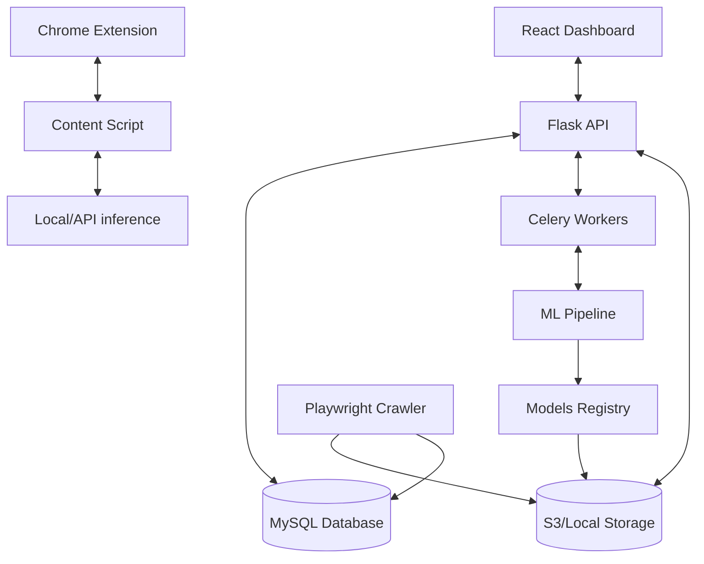

# Architecture

## System Diagram

## Components

### Frontend
- **Technology**: React, Vite, TypeScript, Tailwind CSS, Recharts
- **Responsibilities**: Provide the annotation interface, show dashboards, visualize dataset statistics, and prediction results.

### Backend
- **Technology**: Python 3.11+, Flask, SQLAlchemy, Celery
- **Responsibilities**: REST API, handle auth, orchestrate database inserts, trigger ML jobs.

### Machine Learning
- **Technology**: PyTorch, scikit-learn, HuggingFace Transformers, OpenCV
- **Responsibilities**: Train and inference for Text (TF-IDF, RoBERTa), Vision (ResNet), and Multimodal models. Track experiments via MLflow.

### Database
- **Technology**: MySQL 8+
- **Responsibilities**: Normalized tables for sites, users, datasets, annotations, predictions, and rules.

### Storage
- **Technology**: Local Filesystem (dev), S3 (prod)
- **Responsibilities**: Store raw images, DOM JSON dumps, text files, and model artifacts outside of MySQL to prevent database bloat.
